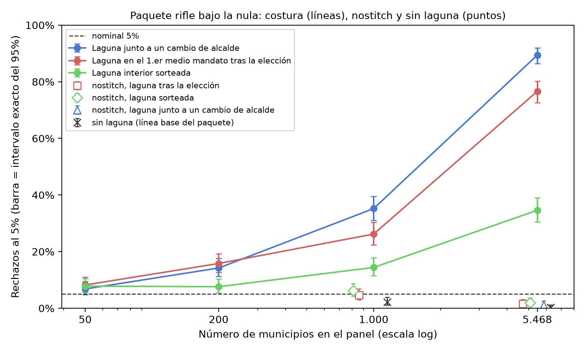

<div align="center">

# ¿El alcalde mejora la ciudad más allá del azar? Un dato faltante en el cambio de alcalde hace que la prueba diga que sí

**En un panel grande, un período faltante junto a un cambio de alcalde, en muchos municipios, basta para que la prueba
de inferencia por aleatorización para efectos del líder (RIFLE) de Berry y Fowler detecte un efecto del líder que no existe.**

[English](README.md) · [Português (Brasil)](README.pt-BR.md) · **Español** · [Italiano](README.it.md) · [עברית](README.he.md)

[](https://doi.org/10.5281/zenodo.24044367)


</div>

> [!IMPORTANT]
> **Hallazgo.** Con ruido autorregresivo de coeficiente 0,217 y ningún efecto del alcalde, la costura de lagunas por
> defecto del paquete rechaza la hipótesis nula verdadera en el **76,6%** de las bases con la laguna en el período 9 y
> en el **89,4%** con la laguna junto a un cambio de alcalde, en el panel de 5.468 municipios brasileños. Con 50
> municipios, la misma laguna da del 6,8% al 8,2%. La propia opción `nostitch` del paquete elimina esta inflación (del
> 1,2% al 2,0% en el panel completo).

## El artículo

| Idioma | PDF | DOCX |
|---|---|---|
| Portugués (Brasil), original | [`paper-final.pdf`](docs/paper/paper-final.pdf) | [`paper-final.docx`](docs/paper/paper-final.docx) |
| Inglés, traducción | [`paper-final-en.pdf`](docs/paper/paper-final-en.pdf) | [`paper-final-en.docx`](docs/paper/paper-final-en.docx) |
| Español, traducción | [`paper-final-es.pdf`](docs/paper/paper-final-es.pdf) | [`paper-final-es.docx`](docs/paper/paper-final-es.docx) |
| Italiano, traducción | [`paper-final-it.pdf`](docs/paper/paper-final-it.pdf) | [`paper-final-it.docx`](docs/paper/paper-final-it.docx) |

Cada edición trae sus figuras y la Tabla 1 en su propio idioma. Los lectores de hebreo cuentan con la edición en inglés.

## Qué aporta este trabajo

1. **La magnitud del problema** en la estructura real de mandatos de un panel grande, en una traducción del camino
   por defecto del código oficial: de unos pocos puntos con 50 municipios al 89,4% con 5.468.
2. **Los ejemplos de cambio de signo**: la misma laguna corta favorece el ajuste real cuando separa líderes distintos
   que no regresan, y puede empujar la prueba hacia el lado conservador dentro de un mandato o cuando el líder regresa
   (Sección 3.2, con enumeración exacta).
3. **Un diagnóstico** para decidir cuándo usar `nostitch`, que los autores del paquete ya ofrecen: la posición de la
   laguna respecto a los cambios de líder, la autocorrelación residual y el tamaño de la prueba bajo la hipótesis nula
   con la estructura real.

## De un vistazo

| Elemento | Valor |
|---|---|
| Prueba estudiada | RIFLE (Berry & Fowler, 2021), paquete de Stata `rifle` (SSC S458461), camino por defecto |
| Estructura | mandatos reales de 5.468 municipios, diez medios mandatos de 2005 a 2024 |
| Variable de resultado | sintética: AR(1) gaussiano, ρ = 0,217 (calibrado en el índice del estudio de origen) |
| Celdas | 500 bases y 1.000 permutaciones cada una; intervalos exactos de Clopper-Pearson |

## Inicio rápido

```bash
python -m venv .venv && .venv/bin/pip install -r requirements.lock
.venv/bin/python run_all.py              # light path: minutes
.venv/bin/python run_all.py --completo   # re-runs the simulations: hours of CPU
```

Salida esperada del camino ligero (el `chain_head` es el de la ejecución sellada en `runs/`):

```text
[PASS] CHAIN INTACT — chain_head <hex> (<run_id>)
... passed
[OK] .../output/results.json (21 fontes conferidas)
[PASS] figuras, tabelas, numeros ancorados e locales — tudo bate
[PASS] replicação concluída; cadeia íntegra
```

## Resultados

| Celda (traducción fiel del paquete) | 50 municipios | 1.000 | 5.468 |
|---|---|---|---|
| Laguna junto a un cambio de alcalde, cosida | 6,8% | 35,2% | 89,4% |
| Laguna en el período 9, cosida | 8,2% | 26,2% | 76,6% |
| Laguna interior aleatoria, cosida | 7,8% | 14,4% | 34,6% |
| Laguna en el período 9, `nostitch` | — | 4,6% | 1,6% |
| Sin laguna | — | 2,2% | 0,2% |



La Tabla 1 completa, con el número efectivo de municipios y de observaciones en cada celda, está en
[`output/tables/tab1_celulas.es.md`](output/tables/tab1_celulas.es.md).

## Qué se afirma y qué no

| Se afirma | No se afirma |
|---|---|
| La costura por defecto infla el tamaño de la prueba cuando la laguna separa alcaldes distintos, bajo correlación serial, y más en los paneles grandes examinados | Que algún resultado publicado de Berry y Fowler sea erróneo |
| `nostitch` elimina esta inflación en las celdas probadas, con una potencia similar a la del control donde se midió | Que `nostitch` sea una garantía universal, o que preserve la potencia en toda posición de la laguna |
| La proporción de lagunas junto a un cambio de líder es un diagnóstico útil | Que sea una regla suficiente; o que la relación con N esté aislada de la composición del panel |

**Congelado, no se vuelve a ejecutar aquí:** el propio motor de simulación del estudio de origen, el piloto antiguo y
el análisis de los datos reales (dependen de datos con identificadores personales). Véase [`REPRODUCIBILITY.md`](REPRODUCIBILITY.md).

## Integridad

`configs/stages.json` define una cadena de Merkle por etapas (entorno, prerregistro, datos, cadenas de origen, código,
salidas congeladas, resultados, tablas, artículo). `scripts/build_run.py` sella una ejecución en
`runs/<UTC>/manifest.json` con `checksums.sha256`; `python scripts/verify_chain.py` recalcula todo desde el disco y
termina con el número de discrepancias (0 = íntegra).

## Idioma de los archivos

El README principal (`README.md`), `REPRODUCIBILITY.md`, `docs/algorithm.md` y los metadatos están en inglés, con
READMEs en cuatro idiomas más. Los comentarios del código, los nombres de las pruebas, los mensajes de los scripts, el
prerregistro (un documento fechado), las salidas congeladas y las cadenas de hash de origen están en portugués y se
mantienen tal como se registraron: traducirlos reescribiría evidencia sellada.

## Estructura de carpetas

```text
code/            rifle.ado port, anonymized panel, faithful-port simulations, results assembly
data/            mandatos.csv (anonymized tenures), mascara_indice.csv, parametros.json,
                 PREREGISTRATION.md, numeros_publicados.json (every anchored number of the paper, per edition)
data/congelado/  21 outputs of the origin study with pinned sha256
data/origem/     hash chains of the origin study (pilot, analysis, preregistration)
docs/paper/      the paper in four editions (PDF and DOCX)
docs/            algorithm.md (formal specification of the test and the mechanism) and the log of the
                 full run (byte-for-byte equality)
locales/         figure and table labels in pt-BR, en, es and it
output/          results.json, figures (PNG and SVG) and Table 1, in four languages
runs/            the sealed run (manifest.json + checksums.sha256)
scripts/         figures, table, number verifier, provenance chain
stata/           rifle_celulas.do (comparison with the official package; untested)
tests/           tests that lock the published numbers
```

## Autor

**Carlos Ulisses Flores** — Codex Hash Research Laboratory, Codex Hash Ltda., Brasil

[](https://orcid.org/0000-0002-6034-7765)
[](https://ulissesflores.com)
[](http://lattes.cnpq.br/6905246706890561)

## Cita

DOI de concepto (todas las versiones, siempre resuelve a la más reciente): [10.5281/zenodo.24044367](https://doi.org/10.5281/zenodo.24044367). Cada release tiene además
su propio DOI de versión, indicado en el registro de Zenodo. Véase [`CITATION.cff`](CITATION.cff).

```bibtex
@software{flores_2026_rifle_gap_bias,
  author    = {Flores, Carlos Ulisses},
  title     = {Does a mayor improve a city beyond chance? Missing data at a change of mayor makes the test say yes: Replication package},
  year      = {2026},
  version   = {1.0.0},
  publisher = {Zenodo},
  doi       = {10.5281/zenodo.24044367},
  url       = {https://github.com/ulissesflores/rifle-gap-bias}
}
```

## Licencia

Código bajo Apache-2.0; texto del artículo y figuras bajo CC BY 4.0. Véase [`NOTICE`](NOTICE).

## Referencias de anclaje

- Berry, C. R., & Fowler, A. (2021). Leadership or luck? Randomization inference for leader effects in politics,
  business, and sports. *Science Advances*, 7(4), eabe3404. https://doi.org/10.1126/sciadv.abe3404
- Berry, C. R., & Fowler, A. (2018). *RIFLE: Stata module to perform randomization inference for leader effects*
  (SSC S458461). https://ideas.repec.org/c/boc/bocode/s458461.html
