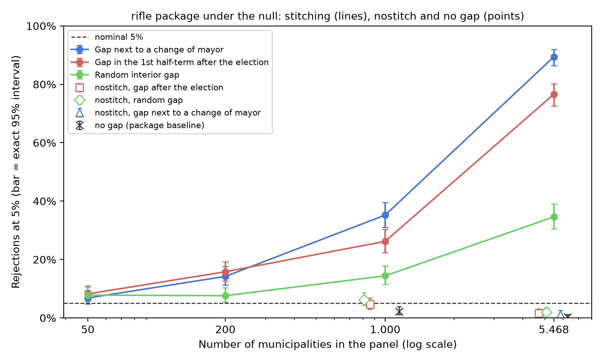

<div align="center">

# האם ראש העיר משפר את העיר מעבר למקרה? נתון חסר בחילופי ראש העיר גורם למבחן לומר כן

**בפאנל גדול, תקופה חסרה אחת סמוך לחילופי ראש עיר, ברשויות מקומיות רבות, מספיקה כדי שמבחן ההסקה באמצעות רנדומיזציה
לאפקטים של מנהיג (RIFLE) של ברי ופאולר (Berry and Fowler) יזהה אפקט מנהיג שאינו קיים.**

[English](README.md) · [Português (Brasil)](README.pt-BR.md) · [Español](README.es.md) · [Italiano](README.it.md) · **עברית**


</div>

<div dir="rtl">

> [!IMPORTANT]
> **ממצא.** עם רעש אוטורגרסיבי במקדם 0.217 וללא כל אפקט של ראש העיר, תפירת הפערים שבברירת המחדל של החבילה דוחה את
> השערת האפס הנכונה ב-**76.6%** ממערכי הנתונים שבהם הפער נמצא בתקופה 9, וב-**89.4%** כאשר הפער סמוך לחילופי ראש עיר,
> בפאנל של 5,468 רשויות מקומיות בברזיל. עם 50 רשויות מקומיות, אותו פער נותן 6.8% עד 8.2%. האפשרות `nostitch` של
> החבילה עצמה מבטלת את הניפוח הזה (1.2% עד 2.0% בפאנל המלא).

## המאמר

המאמר (PDF ו-DOCX בפורטוגזית, שפת המקור, ובתרגומים לאנגלית, לספרדית ולאיטלקית) ייכנס למאגר זה עם הגרסה הסופית,
לאחר שייווצר ה-DOI. קוראי עברית מופנים למהדורה האנגלית. האיורים שלו וטבלה 1 נוצרים כאן בכל ארבע השפות
(`output/figures/`, `output/tables/`).

## מה תורמת עבודה זו

1. **גודל הבעיה** על מבנה הכהונות האמיתי של פאנל גדול, בתרגום של נתיב ברירת המחדל של הקוד הרשמי: מנקודות ספורות
   עם 50 רשויות מקומיות ועד 89.4% עם 5,468.
2. **הדוגמאות להיפוך סימן**: אותו פער קצר מיטיב עם ההתאמה האמיתית כאשר הוא מפריד בין מנהיגים שונים שאינם חוזרים,
   ועשוי לדחוף את המבחן לצד השמרני בתוך כהונה או כאשר המנהיג חוזר (סעיף 3.2, עם מנייה מדויקת).
3. **אבחון** להחלטה מתי להשתמש ב-`nostitch`, שמחברי החבילה כבר מספקים: מיקום הפער ביחס לחילופי מנהיגים, המתאם
   העצמי של השאריות וגודל המבחן תחת השערת האפס עם המבנה האמיתי.

## במבט חטוף

| פריט | ערך |
|---|---|
| המבחן הנחקר | RIFLE (Berry & Fowler, 2021), חבילת Stata `rifle` (SSC S458461), נתיב ברירת המחדל |
| מבנה | כהונות אמיתיות של 5,468 רשויות מקומיות, עשר מחציות כהונה מ-2005 עד 2024 |
| משתנה תוצאה | סינתטי: AR(1) גאוסיאני, ρ = 0.217 (מכויל על המדד של מחקר המקור) |
| תאים | 500 מערכי נתונים ו-1,000 פרמוטציות לכל אחד; רווחים מדויקים של Clopper-Pearson |

## התחלה מהירה

</div>

```bash
python -m venv .venv && .venv/bin/pip install -r requirements.lock
.venv/bin/python run_all.py              # light path: minutes
.venv/bin/python run_all.py --completo   # re-runs the simulations: hours of CPU
```

<div dir="rtl">

פלט צפוי של הנתיב הקל (ה-`chain_head` הוא זה של הריצה החתומה ב-`runs/`):

</div>

```text
[PASS] CHAIN INTACT — chain_head <hex> (<run_id>)
... passed
[OK] .../output/results.json (21 fontes conferidas)
[PASS] figuras, tabelas, numeros ancorados e locales — tudo bate
[PASS] replicação concluída; cadeia íntegra
```

<div dir="rtl">

## תוצאות

| תא (העברה נאמנה של החבילה) | 50 רשויות מקומיות | 1,000 | 5,468 |
|---|---|---|---|
| פער סמוך לחילופי ראש עיר, תפור | 6.8% | 35.2% | 89.4% |
| פער בתקופה 9, תפור | 8.2% | 26.2% | 76.6% |
| פער פנימי אקראי, תפור | 7.8% | 14.4% | 34.6% |
| פער בתקופה 9, `nostitch` | — | 4.6% | 1.6% |
| ללא פער | — | 2.2% | 0.2% |



טבלה 1 המלאה, עם המספר האפקטיבי של רשויות מקומיות ושל תצפיות בכל תא, נמצאת
ב-[`output/tables/tab1_celulas.en.md`](output/tables/tab1_celulas.en.md).

## מה נטען ומה לא נטען

| נטען | לא נטען |
|---|---|
| תפירת ברירת המחדל מנפחת את גודל המבחן כאשר הפער מפריד בין ראשי ערים שונים, תחת מתאם סדרתי, ויותר מכך בפאנלים הגדולים שנבדקו | שתוצאה כלשהי שפרסמו ברי ופאולר שגויה |
| `nostitch` מבטלת את הניפוח הזה בתאים שנבדקו, עם עוצמה דומה לזו של קבוצת הביקורת היכן שנמדדה | ש-`nostitch` היא ערובה אוניברסלית, או שהיא משמרת את העוצמה בכל מיקום של הפער |
| שיעור הפערים הסמוכים לחילופי מנהיג הוא אבחון שימושי | שזהו כלל מספיק; או שהקשר עם N מבודד מהרכב הפאנל |

**מוקפא, לא מורץ מחדש כאן:** מנוע הסימולציה של מחקר המקור עצמו, הפיילוט הישן והניתוח של הנתונים האמיתיים (הם
תלויים בנתונים עם מזהים אישיים). ראו [`REPRODUCIBILITY.md`](REPRODUCIBILITY.md).

## שלמות

`configs/stages.json` מגדיר שרשרת מרקל מדורגת (סביבה, רישום מוקדם, נתונים, שרשראות מקור, קוד, פלטים מוקפאים,
תוצאות, טבלאות, מאמר). `scripts/build_run.py` חותם ריצה ב-`runs/<UTC>/manifest.json` עם `checksums.sha256`;
`python scripts/verify_chain.py` מחשב הכול מחדש מהדיסק ויוצא עם מספר אי-ההתאמות (0 = שלמה).

## שפת הקבצים

ה-README הראשי (`README.md`), `REPRODUCIBILITY.md`, `docs/algorithm.md` והמטא-נתונים כתובים באנגלית, עם קובצי
README בארבע שפות נוספות. הערות הקוד, שמות הבדיקות, הודעות הסקריפטים, הרישום המוקדם (מסמך מתוארך), הפלטים
המוקפאים ושרשראות הגיבוב של המקור כתובים בפורטוגזית ונשארים כפי שנרשמו: תרגומם היה משכתב ראיות חתומות.

## מבנה התיקיות

</div>

```text
code/            rifle.ado port, anonymized panel, faithful-port simulations, results assembly
data/            mandatos.csv (anonymized tenures), mascara_indice.csv, parametros.json,
                 PREREGISTRATION.md, numeros_publicados.json (every anchored number of the paper, per edition)
data/congelado/  21 outputs of the origin study with pinned sha256
data/origem/     hash chains of the origin study (pilot, analysis, preregistration)
docs/            algorithm.md (formal specification of the test and the mechanism) and the log of the
                 full run (byte-for-byte equality)
locales/         figure and table labels in pt-BR, en, es and it
output/          results.json, figures (PNG and SVG) and Table 1, in four languages
runs/            the sealed run (manifest.json + checksums.sha256)
scripts/         figures, table, number verifier, provenance chain
stata/           rifle_celulas.do (comparison with the official package; untested)
tests/           tests that lock the published numbers
```

<div dir="rtl">

## מחבר

**Carlos Ulisses Flores** — Codex Hash Research Laboratory, Codex Hash Ltda., ברזיל

[](https://orcid.org/0000-0002-6034-7765)
[](https://ulissesflores.com)
[](http://lattes.cnpq.br/6905246706890561)

## ציטוט

ה-DOI נוצר עם ה-release הראשון של מאגר זה; עד אז, השתמשו ב-[`CITATION.cff`](CITATION.cff).

</div>

```bibtex
@software{flores_2026_rifle_gap_bias,
  author  = {Flores, Carlos Ulisses},
  title   = {Does a mayor improve a city beyond chance? Missing data at a change of mayor makes the test say yes: Replication package},
  year    = {2026},
  version = {1.0.0},
  url     = {https://github.com/ulissesflores/rifle-gap-bias}
}
```

<div dir="rtl">

## רישיון

קוד תחת Apache-2.0; טקסט המאמר והאיורים תחת CC BY 4.0. ראו [`NOTICE`](NOTICE).

## מקורות עוגן

- Berry, C. R., & Fowler, A. (2021). Leadership or luck? Randomization inference for leader effects in politics,
  business, and sports. *Science Advances*, 7(4), eabe3404. https://doi.org/10.1126/sciadv.abe3404
- Berry, C. R., & Fowler, A. (2018). *RIFLE: Stata module to perform randomization inference for leader effects*
  (SSC S458461). https://ideas.repec.org/c/boc/bocode/s458461.html

</div>
