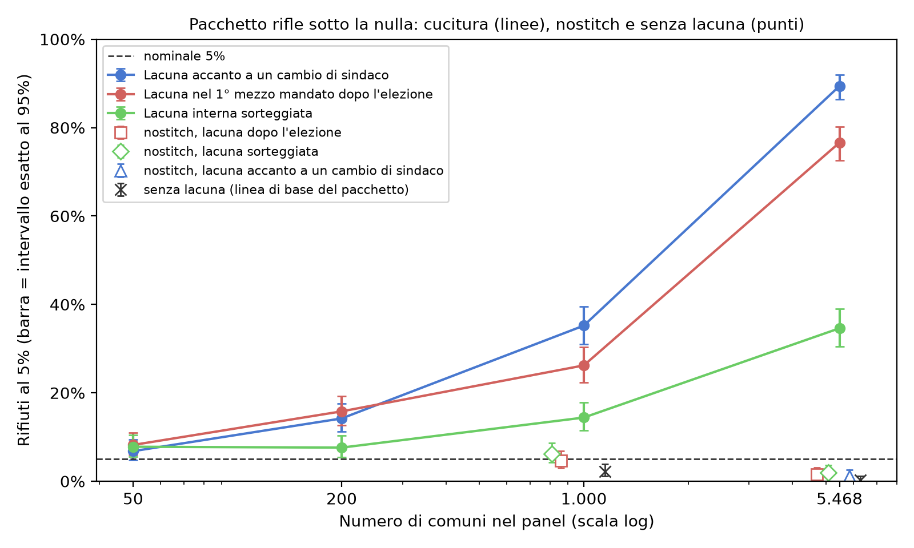

<div align="center">

# Il sindaco migliora la città oltre il caso? Un dato mancante al cambio di sindaco fa dire sì al test

**In un panel ampio, un periodo mancante accanto a un cambio di sindaco, in molti comuni, basta perché il test di
inferenza per randomizzazione per gli effetti del leader (RIFLE) di Berry e Fowler rilevi un effetto del leader che non esiste.**

[English](README.md) · [Português (Brasil)](README.pt-BR.md) · [Español](README.es.md) · **Italiano** · [עברית](README.he.md)


</div>

> [!IMPORTANT]
> **Risultato.** Con rumore autoregressivo di coefficiente 0,217 e nessun effetto del sindaco, la cucitura delle lacune
> predefinita del pacchetto rifiuta l'ipotesi nulla vera nel **76,6%** delle basi con la lacuna nel periodo 9 e
> nell'**89,4%** con la lacuna accanto a un cambio di sindaco, nel panel di 5.468 comuni brasiliani. Con 50 comuni, la
> stessa lacuna dà dal 6,8% all'8,2%. L'opzione `nostitch` del pacchetto stesso elimina questa inflazione (dall'1,2% al
> 2,0% nel panel completo).

## L'articolo

L'articolo (PDF e DOCX in portoghese, l'originale, e nelle traduzioni in inglese, spagnolo e italiano) entra in questo
repository con la versione finale, una volta che il DOI esisterà. I lettori di ebraico possono fare riferimento
all'edizione inglese. Le sue figure e la Tabella 1 sono generate qui in tutte e quattro le lingue (`output/figures/`,
`output/tables/`).

## Che cosa apporta questo lavoro

1. **La dimensione del problema** sulla struttura reale dei mandati di un panel ampio, in una traduzione del percorso
   predefinito del codice ufficiale: da pochi punti con 50 comuni all'89,4% con 5.468.
2. **Gli esempi di inversione di segno**: la stessa lacuna breve favorisce l'adattamento reale quando separa leader
   diversi che non ritornano, e può spingere il test verso il lato conservativo all'interno di un mandato o quando il
   leader ritorna (Sezione 3.2, con enumerazione esatta).
3. **Una diagnosi** per decidere quando usare `nostitch`, che gli autori del pacchetto già forniscono: la posizione
   della lacuna rispetto ai cambi di leader, l'autocorrelazione residua e l'ampiezza del test sotto l'ipotesi nulla con
   la struttura reale.

## In sintesi

| Voce | Valore |
|---|---|
| Test studiato | RIFLE (Berry & Fowler, 2021), pacchetto Stata `rifle` (SSC S458461), percorso predefinito |
| Struttura | mandati reali di 5.468 comuni, dieci mezzi mandati dal 2005 al 2024 |
| Esito | sintetico: AR(1) gaussiano, ρ = 0,217 (calibrato sull'indice dello studio di origine) |
| Celle | 500 basi e 1.000 permutazioni ciascuna; intervalli esatti di Clopper-Pearson |

## Avvio rapido

```bash
python -m venv .venv && .venv/bin/pip install -r requirements.lock
.venv/bin/python run_all.py              # light path: minutes
.venv/bin/python run_all.py --completo   # re-runs the simulations: hours of CPU
```

Output atteso del percorso leggero (il `chain_head` è quello dell'esecuzione sigillata in `runs/`):

```text
[PASS] CHAIN INTACT — chain_head <hex> (<run_id>)
... passed
[OK] .../output/results.json (21 fontes conferidas)
[PASS] figuras, tabelas, numeros ancorados e locales — tudo bate
[PASS] replicação concluída; cadeia íntegra
```

## Risultati

| Cella (traduzione fedele del pacchetto) | 50 comuni | 1.000 | 5.468 |
|---|---|---|---|
| Lacuna accanto a un cambio di sindaco, cucita | 6,8% | 35,2% | 89,4% |
| Lacuna nel periodo 9, cucita | 8,2% | 26,2% | 76,6% |
| Lacuna interna casuale, cucita | 7,8% | 14,4% | 34,6% |
| Lacuna nel periodo 9, `nostitch` | — | 4,6% | 1,6% |
| Nessuna lacuna | — | 2,2% | 0,2% |



La Tabella 1 completa, con il numero effettivo di comuni e di osservazioni in ogni cella, si trova in
[`output/tables/tab1_celulas.it.md`](output/tables/tab1_celulas.it.md).

## Che cosa si afferma e che cosa no

| Si afferma | Non si afferma |
|---|---|
| La cucitura predefinita gonfia l'ampiezza del test quando la lacuna separa sindaci diversi, in presenza di correlazione seriale, e più nei panel ampi esaminati | Che un qualsiasi risultato pubblicato da Berry e Fowler sia errato |
| `nostitch` elimina questa inflazione nelle celle testate, con potenza simile a quella del controllo dove è stata misurata | Che `nostitch` sia una garanzia universale, o che preservi la potenza in ogni posizione della lacuna |
| La quota di lacune accanto a un cambio di leader è una diagnosi utile | Che sia una regola sufficiente; o che la relazione con N sia isolata dalla composizione del panel |

**Congelato, non rieseguito qui:** il motore di simulazione dello studio di origine stesso, il vecchio pilota e
l'analisi dei dati reali (dipendono da dati con identificatori personali). Vedi [`REPRODUCIBILITY.md`](REPRODUCIBILITY.md).

## Integrità

`configs/stages.json` definisce una catena di Merkle a stadi (ambiente, preregistrazione, dati, catene di origine,
codice, output congelati, risultati, tabelle, articolo). `scripts/build_run.py` sigilla un'esecuzione in
`runs/<UTC>/manifest.json` con `checksums.sha256`; `python scripts/verify_chain.py` ricalcola tutto dal disco ed esce
con il numero di discrepanze (0 = integra).

## Lingua dei file

Il README principale (`README.md`), `REPRODUCIBILITY.md`, `docs/algorithm.md` e i metadati sono in inglese, con README
in altre quattro lingue. I commenti del codice, i nomi dei test, i messaggi degli script, la preregistrazione (un
documento datato), gli output congelati e le catene di hash di origine sono in portoghese e restano come sono stati
registrati: tradurli significherebbe riscrivere evidenze sigillate.

## Struttura delle cartelle

```text
code/            rifle.ado port, anonymized panel, faithful-port simulations, results assembly
data/            mandatos.csv (anonymized tenures), mascara_indice.csv, parametros.json,
                 PREREGISTRATION.md, numeros_publicados.json (every anchored number of the paper, per edition)
data/congelado/  21 outputs of the origin study with pinned sha256
data/origem/     hash chains of the origin study (pilot, analysis, preregistration)
docs/            algorithm.md (formal specification of the test and the mechanism) and the log of the
                 full run (byte-for-byte equality)
locales/         figure and table labels in pt-BR, en, es and it
output/          results.json, figures (PNG and SVG) and Table 1, in four languages
runs/            the sealed run (manifest.json + checksums.sha256)
scripts/         figures, table, number verifier, provenance chain
stata/           rifle_celulas.do (comparison with the official package; untested)
tests/           tests that lock the published numbers
```

## Autore

**Carlos Ulisses Flores** — Codex Hash Research Laboratory, Codex Hash Ltda., Brasile

[](https://orcid.org/0000-0002-6034-7765)
[](https://ulissesflores.com)
[](http://lattes.cnpq.br/6905246706890561)

## Citazione

Il DOI viene creato dalla prima release di questo repository; fino ad allora, usare [`CITATION.cff`](CITATION.cff).

```bibtex
@software{flores_2026_rifle_gap_bias,
  author  = {Flores, Carlos Ulisses},
  title   = {Does a mayor improve a city beyond chance? Missing data at a change of mayor makes the test say yes: Replication package},
  year    = {2026},
  version = {1.0.0},
  url     = {https://github.com/ulissesflores/rifle-gap-bias}
}
```

## Licenza

Codice sotto Apache-2.0; testo dell'articolo e figure sotto CC BY 4.0. Vedi [`NOTICE`](NOTICE).

## Riferimenti di ancoraggio

- Berry, C. R., & Fowler, A. (2021). Leadership or luck? Randomization inference for leader effects in politics,
  business, and sports. *Science Advances*, 7(4), eabe3404. https://doi.org/10.1126/sciadv.abe3404
- Berry, C. R., & Fowler, A. (2018). *RIFLE: Stata module to perform randomization inference for leader effects*
  (SSC S458461). https://ideas.repec.org/c/boc/bocode/s458461.html
