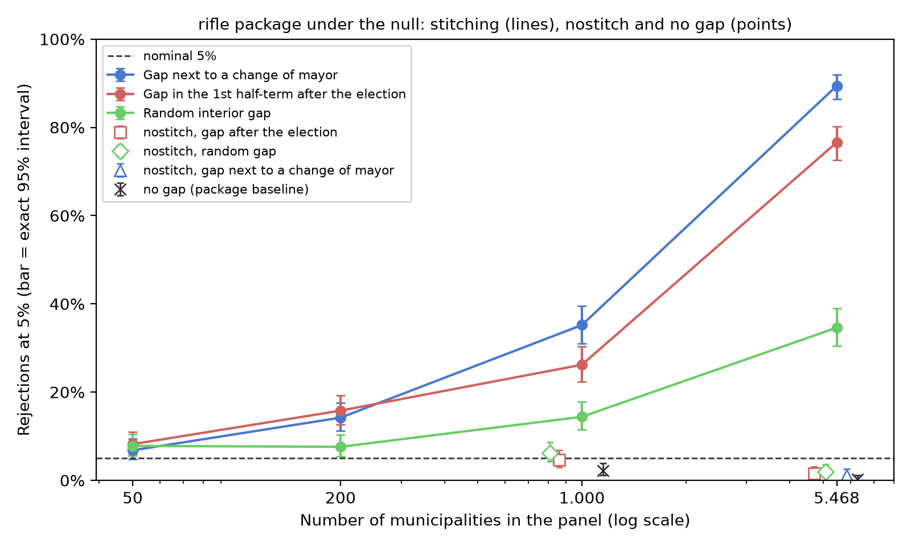

<div align="center">

# Does a mayor improve a city beyond chance? Missing data at a change of mayor makes the test say yes

**In a large panel, one missing period next to a change of mayor, in many municipalities, is enough for Berry and
Fowler's randomization inference test for leader effects (RIFLE) to detect a leader effect that does not exist.**

**English** · [Português (Brasil)](README.pt-BR.md) · [Español](README.es.md) · [Italiano](README.it.md) · [עברית](README.he.md)

[](https://doi.org/10.5281/zenodo.24044367)


</div>

> [!IMPORTANT]
> **Finding.** With autoregressive noise of coefficient 0.217 and no mayor effect at all, the package's default gap
> stitching rejects the true null in **76.6%** of the datasets with the gap in period 9 and in **89.4%** with the gap
> next to a change of mayor, in the panel of 5,468 Brazilian municipalities. With 50 municipalities, the same gap
> gives 6.8% to 8.2%. The package's own `nostitch` option removes this inflation (1.2% to 2.0% in the full panel).

## The paper

| Language | PDF | DOCX |
|---|---|---|
| Portuguese (Brazil), original | [`paper-final.pdf`](docs/paper/paper-final.pdf) | [`paper-final.docx`](docs/paper/paper-final.docx) |
| English, translation | [`paper-final-en.pdf`](docs/paper/paper-final-en.pdf) | [`paper-final-en.docx`](docs/paper/paper-final-en.docx) |
| Spanish, translation | [`paper-final-es.pdf`](docs/paper/paper-final-es.pdf) | [`paper-final-es.docx`](docs/paper/paper-final-es.docx) |
| Italian, translation | [`paper-final-it.pdf`](docs/paper/paper-final-it.pdf) | [`paper-final-it.docx`](docs/paper/paper-final-it.docx) |

Each edition has its figures and Table 1 in its own language. Hebrew readers are served by the English edition.

## What this work contributes

1. **The size of the problem** on the real tenure structure of a large panel, in a translation of the default path
   of the official code: from a few points with 50 municipalities to 89.4% with 5,468.
2. **The sign-change examples**: the same short gap favors the real fit when it separates different leaders who do
   not return, and can push the test to the conservative side inside a tenure or when the leader returns
   (Section 3.2, with exact enumeration).
3. **A diagnosis** for deciding when to use `nostitch`, which the package authors already provide: the position of
   the gap relative to leader changes, the residual autocorrelation and the test size under the null with the real
   structure.

## At a glance

| Item | Value |
|---|---|
| Test studied | RIFLE (Berry & Fowler, 2021), Stata package `rifle` (SSC S458461), default path |
| Structure | real tenures of 5,468 municipalities, ten half-terms from 2005 to 2024 |
| Outcome | synthetic: Gaussian AR(1), ρ = 0.217 (calibrated on the origin study's index) |
| Cells | 500 datasets and 1,000 permutations each; exact Clopper-Pearson intervals |

## Quick start

```bash
python -m venv .venv && .venv/bin/pip install -r requirements.lock
.venv/bin/python run_all.py              # light path: minutes
.venv/bin/python run_all.py --completo   # re-runs the simulations: hours of CPU
```

Expected output of the light path (the `chain_head` is the one of the sealed run in `runs/`):

```text
[PASS] CHAIN INTACT — chain_head <hex> (<run_id>)
... passed
[OK] .../output/results.json (21 fontes conferidas)
[PASS] figuras, tabelas, numeros ancorados e locales — tudo bate
[PASS] replicação concluída; cadeia íntegra
```

## Results

| Cell (faithful port of the package) | 50 municipalities | 1,000 | 5,468 |
|---|---|---|---|
| Gap next to a change of mayor, stitched | 6.8% | 35.2% | 89.4% |
| Gap in period 9, stitched | 8.2% | 26.2% | 76.6% |
| Random interior gap, stitched | 7.8% | 14.4% | 34.6% |
| Gap in period 9, `nostitch` | — | 4.6% | 1.6% |
| No gap | — | 2.2% | 0.2% |



The full Table 1, with the effective number of municipalities and observations in each cell, is in
[`output/tables/tab1_celulas.en.md`](output/tables/tab1_celulas.en.md).

## What is and isn't claimed

| Claimed | Not claimed |
|---|---|
| Default stitching inflates test size when the gap separates different mayors, under serial correlation, and more so in the large panels examined | That any published result by Berry and Fowler is wrong |
| `nostitch` removes this inflation in the cells tested, with power similar to the control where it was measured | That `nostitch` is a universal guarantee, or that it preserves power at every gap position |
| The share of gaps next to a change of leader is a useful diagnosis | That it is a sufficient rule; or that the relation with N is isolated from panel composition |

**Frozen, not re-run here:** the origin study's own simulation engine, the old pilot and the analysis of the real
data (they depend on data with personal identifiers). See [`REPRODUCIBILITY.md`](REPRODUCIBILITY.md).

## Integrity

`configs/stages.json` defines a staged Merkle chain (environment, preregistration, data, origin chains, code,
frozen outputs, results, tables, paper). `scripts/build_run.py` seals a run in `runs/<UTC>/manifest.json` with
`checksums.sha256`; `python scripts/verify_chain.py` recomputes everything from disk and exits with the number of
mismatches (0 = intact).

## Language of the files

This README, `REPRODUCIBILITY.md`, `docs/algorithm.md` and the metadata are in English, with READMEs in four more
languages. Code comments, test names, script messages, the preregistration (a dated document), the frozen outputs
and the origin hash chains are in Portuguese and stay as recorded: translating them would rewrite sealed evidence.

## Layout

```text
code/            rifle.ado port, anonymized panel, faithful-port simulations, results assembly
data/            mandatos.csv (anonymized tenures), mascara_indice.csv, parametros.json,
                 PREREGISTRATION.md, numeros_publicados.json (every anchored number of the paper, per edition)
data/congelado/  21 outputs of the origin study with pinned sha256
data/origem/     hash chains of the origin study (pilot, analysis, preregistration)
docs/paper/      the paper in four editions (PDF and DOCX)
docs/            algorithm.md (formal specification of the test and the mechanism) and the log of the
                 full run (byte-for-byte equality)
locales/         figure and table labels in pt-BR, en, es and it
output/          results.json, figures (PNG and SVG) and Table 1, in four languages
runs/            the sealed run (manifest.json + checksums.sha256)
scripts/         figures, table, number verifier, provenance chain
stata/           rifle_celulas.do (comparison with the official package; untested)
tests/           tests that lock the published numbers
```

## Author

**Carlos Ulisses Flores** — Codex Hash Research Laboratory, Codex Hash Ltda., Brazil

[](https://orcid.org/0000-0002-6034-7765)
[](https://ulissesflores.com)
[](http://lattes.cnpq.br/6905246706890561)

## Citation

Concept DOI (all versions, always resolves to the latest): [10.5281/zenodo.24044367](https://doi.org/10.5281/zenodo.24044367). Each release also
has its own version DOI, listed on the Zenodo record. See [`CITATION.cff`](CITATION.cff).

```bibtex
@software{flores_2026_rifle_gap_bias,
  author    = {Flores, Carlos Ulisses},
  title     = {Does a mayor improve a city beyond chance? Missing data at a change of mayor makes the test say yes: Replication package},
  year      = {2026},
  version   = {1.0.0},
  publisher = {Zenodo},
  doi       = {10.5281/zenodo.24044367},
  url       = {https://github.com/ulissesflores/rifle-gap-bias}
}
```

## License

Code under Apache-2.0; paper text and figures under CC BY 4.0. See [`NOTICE`](NOTICE).

## Anchor references

- Berry, C. R., & Fowler, A. (2021). Leadership or luck? Randomization inference for leader effects in politics,
  business, and sports. *Science Advances*, 7(4), eabe3404. https://doi.org/10.1126/sciadv.abe3404
- Berry, C. R., & Fowler, A. (2018). *RIFLE: Stata module to perform randomization inference for leader effects*
  (SSC S458461). https://ideas.repec.org/c/boc/bocode/s458461.html
