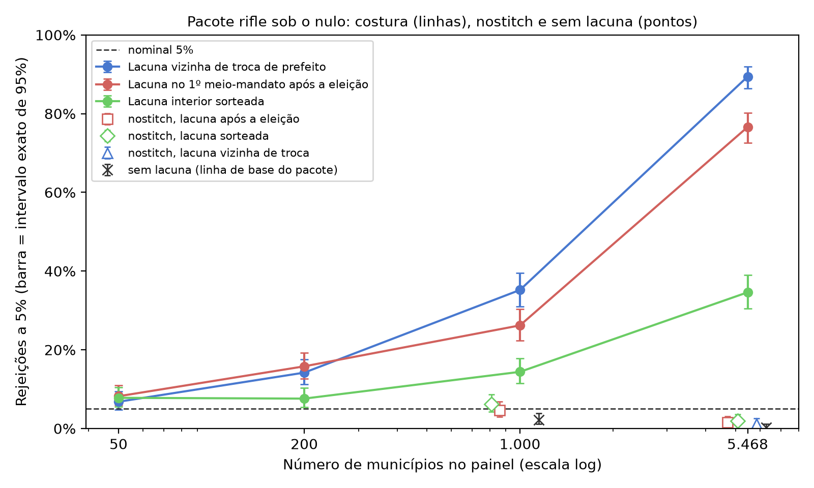

<div align="center">

# O prefeito melhora a cidade além do acaso? Dado faltando na troca de prefeito faz o teste dizer que sim

**Em um painel grande, um período faltando junto a uma troca de prefeito, em muitos municípios, basta para que o teste
de inferência por aleatorização para efeitos de líder (RIFLE) de Berry e Fowler detecte um efeito de líder que não existe.**

[English](README.md) · **Português (Brasil)** · [Español](README.es.md) · [Italiano](README.it.md) · [עברית](README.he.md)

[](https://doi.org/10.5281/zenodo.24044367)


</div>

> [!IMPORTANT]
> **Achado.** Com ruído autorregressivo de coeficiente 0,217 e nenhum efeito de prefeito, a costura de lacunas padrão
> do pacote rejeita o nulo verdadeiro em **76,6%** das bases com a lacuna no período 9 e em **89,4%** com a lacuna
> junto a uma troca de prefeito, no painel de 5.468 municípios brasileiros. Com 50 municípios, a mesma lacuna dá de
> 6,8% a 8,2%. A própria opção `nostitch` do pacote remove essa inflação (de 1,2% a 2,0% no painel completo).

## O artigo

| Idioma | PDF | DOCX |
|---|---|---|
| Português (Brasil), original | [`paper-final.pdf`](docs/paper/paper-final.pdf) | [`paper-final.docx`](docs/paper/paper-final.docx) |
| Inglês, tradução | [`paper-final-en.pdf`](docs/paper/paper-final-en.pdf) | [`paper-final-en.docx`](docs/paper/paper-final-en.docx) |
| Espanhol, tradução | [`paper-final-es.pdf`](docs/paper/paper-final-es.pdf) | [`paper-final-es.docx`](docs/paper/paper-final-es.docx) |
| Italiano, tradução | [`paper-final-it.pdf`](docs/paper/paper-final-it.pdf) | [`paper-final-it.docx`](docs/paper/paper-final-it.docx) |

Cada edição traz suas figuras e a Tabela 1 no próprio idioma. Leitores de hebraico são atendidos pela edição em inglês.

## O que este trabalho traz

1. **O tamanho do problema** na estrutura real de mandatos de um painel grande, numa tradução do caminho padrão
   do código oficial: de poucos pontos com 50 municípios a 89,4% com 5.468.
2. **Os exemplos de troca de sinal**: a mesma lacuna curta favorece o ajuste real quando separa líderes diferentes que
   não voltam, e pode empurrar o teste para o lado conservador dentro de um mandato ou quando o líder volta
   (Seção 3.2, com enumeração exata).
3. **Um diagnóstico** para decidir quando usar `nostitch`, que os autores do pacote já oferecem: a posição da lacuna
   em relação às trocas de líder, a autocorrelação residual e o tamanho do teste sob o nulo com a estrutura
   real.

## Visão rápida

| Item | Valor |
|---|---|
| Teste estudado | RIFLE (Berry & Fowler, 2021), pacote Stata `rifle` (SSC S458461), caminho padrão |
| Estrutura | mandatos reais de 5.468 municípios, dez meios-mandatos de 2005 a 2024 |
| Desfecho | sintético: AR(1) gaussiano, ρ = 0,217 (calibrado no índice do estudo de origem) |
| Células | 500 bases e 1.000 permutações cada; intervalos exatos de Clopper-Pearson |

## Início rápido

```bash
python -m venv .venv && .venv/bin/pip install -r requirements.lock
.venv/bin/python run_all.py              # light path: minutes
.venv/bin/python run_all.py --completo   # re-runs the simulations: hours of CPU
```

Saída esperada do caminho leve (o `chain_head` é o da execução selada em `runs/`):

```text
[PASS] CHAIN INTACT — chain_head <hex> (<run_id>)
... passed
[OK] .../output/results.json (21 fontes conferidas)
[PASS] figuras, tabelas, numeros ancorados e locales — tudo bate
[PASS] replicação concluída; cadeia íntegra
```

## Resultados

| Célula (tradução fiel do pacote) | 50 municípios | 1.000 | 5.468 |
|---|---|---|---|
| Lacuna junto a uma troca de prefeito, costurada | 6,8% | 35,2% | 89,4% |
| Lacuna no período 9, costurada | 8,2% | 26,2% | 76,6% |
| Lacuna interior aleatória, costurada | 7,8% | 14,4% | 34,6% |
| Lacuna no período 9, `nostitch` | — | 4,6% | 1,6% |
| Sem lacuna | — | 2,2% | 0,2% |



A Tabela 1 completa, com o número efetivo de municípios e de observações em cada célula, está em
[`output/tables/tab1_celulas.pt-br.md`](output/tables/tab1_celulas.pt-br.md).

## O que se afirma e o que não se afirma

| Afirmado | Não afirmado |
|---|---|
| A costura padrão infla o tamanho do teste quando a lacuna separa prefeitos diferentes, sob correlação serial, e mais nos painéis grandes examinados | Que algum resultado publicado de Berry e Fowler esteja errado |
| `nostitch` remove essa inflação nas células testadas, com poder semelhante ao do controle onde foi medido | Que `nostitch` seja uma garantia universal, ou que preserve o poder em toda posição de lacuna |
| A fração de lacunas junto a uma troca de líder é um diagnóstico útil | Que seja uma regra suficiente; ou que a relação com N esteja isolada da composição do painel |

**Congelado, não reexecutado aqui:** o próprio motor de simulação do estudo de origem, o piloto antigo e a análise dos
dados reais (dependem de dados com identificadores pessoais). Ver [`REPRODUCIBILITY.md`](REPRODUCIBILITY.md).

## Integridade

`configs/stages.json` define uma cadeia de Merkle em estágios (ambiente, pré-registro, dados, cadeias de origem,
código, saídas congeladas, resultados, tabelas, artigo). `scripts/build_run.py` sela uma execução em
`runs/<UTC>/manifest.json` com `checksums.sha256`; `python scripts/verify_chain.py` recalcula tudo a partir do disco
e sai com o número de divergências (0 = íntegra).

## Idioma dos arquivos

O README principal (`README.md`), o `REPRODUCIBILITY.md`, o `docs/algorithm.md` e os metadados estão em inglês, com
READMEs em mais quatro idiomas. Comentários de código, nomes de testes, mensagens de scripts, o pré-registro (um
documento datado), as saídas congeladas e as cadeias de hash de origem estão em português e ficam como foram
registrados: traduzi-los reescreveria evidência selada.

## Estrutura de pastas

```text
code/            rifle.ado port, anonymized panel, faithful-port simulations, results assembly
data/            mandatos.csv (anonymized tenures), mascara_indice.csv, parametros.json,
                 PREREGISTRATION.md, numeros_publicados.json (every anchored number of the paper, per edition)
data/congelado/  21 outputs of the origin study with pinned sha256
data/origem/     hash chains of the origin study (pilot, analysis, preregistration)
docs/paper/      the paper in four editions (PDF and DOCX)
docs/            algorithm.md (formal specification of the test and the mechanism) and the log of the
                 full run (byte-for-byte equality)
locales/         figure and table labels in pt-BR, en, es and it
output/          results.json, figures (PNG and SVG) and Table 1, in four languages
runs/            the sealed run (manifest.json + checksums.sha256)
scripts/         figures, table, number verifier, provenance chain
stata/           rifle_celulas.do (comparison with the official package; untested)
tests/           tests that lock the published numbers
```

## Autor

**Carlos Ulisses Flores** — Codex Hash Research Laboratory, Codex Hash Ltda., Brasil

[](https://orcid.org/0000-0002-6034-7765)
[](https://ulissesflores.com)
[](http://lattes.cnpq.br/6905246706890561)

## Citação

DOI de conceito (todas as versões, sempre resolve para a mais recente): [10.5281/zenodo.24044367](https://doi.org/10.5281/zenodo.24044367). Cada release também
tem seu próprio DOI de versão, listado no registro do Zenodo. Veja [`CITATION.cff`](CITATION.cff).

```bibtex
@software{flores_2026_rifle_gap_bias,
  author    = {Flores, Carlos Ulisses},
  title     = {Does a mayor improve a city beyond chance? Missing data at a change of mayor makes the test say yes: Replication package},
  year      = {2026},
  version   = {1.0.0},
  publisher = {Zenodo},
  doi       = {10.5281/zenodo.24044367},
  url       = {https://github.com/ulissesflores/rifle-gap-bias}
}
```

## Licença

Código sob Apache-2.0; texto do artigo e figuras sob CC BY 4.0. Ver [`NOTICE`](NOTICE).

## Referências-âncora

- Berry, C. R., & Fowler, A. (2021). Leadership or luck? Randomization inference for leader effects in politics,
  business, and sports. *Science Advances*, 7(4), eabe3404. https://doi.org/10.1126/sciadv.abe3404
- Berry, C. R., & Fowler, A. (2018). *RIFLE: Stata module to perform randomization inference for leader effects*
  (SSC S458461). https://ideas.repec.org/c/boc/bocode/s458461.html
